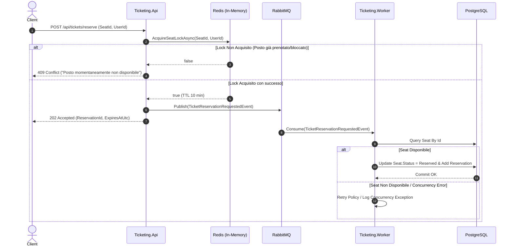

# 🎟️ High Concurrency Ticketing System

🌐 [English](README.md) | **Italiano**

[](https://dotnet.microsoft.com/)
[](https://docs.microsoft.com/dotnet/csharp/)
[](https://www.postgresql.org/)
[](https://redis.io/)
[](https://www.rabbitmq.com/)
[](https://masstransit.io/)
[](https://www.docker.com/)

Un'architettura distribuita ad alte prestazioni ed event-driven progettata per gestire scenari critici di **alta concorrenza** nella prenotazione di biglietti ed eventi (es. concerti, partite, spettacoli ad altissima richiesta), prevenendo qualsiasi fenomeno di **overbooking** e **race condition**.

---

## 📌 Indice

- [Panoramica del Problema](#-panoramica-del-problema)
- [Architettura a 3 Livelli di Difesa](#-architettura-a-3-livelli-di-difesa)
- [Diagramma del Flusso](#-diagramma-del-flusso)
- [Struttura della Solution](#-struttura-della-solution)
- [Stack Tecnologico](#-stack-tecnologico)
- [Prerequisiti](#-prerequisiti)
- [Avvio Rapido](#-avvio-rapido)
- [Documentazione API](#-documentazione-api)
- [Resilienza e Strategie di Concorrenza](#-resilienza-e-strategie-di-concorrenza)
- [Possibili Evoluzioni Future](#-possibili-evoluzioni-future)

---

## 🎯 Panoramica del Problema

Nei sistemi tradizionali di ticketing, quando migliaia di utenti tentano di acquistare lo stesso posto simultaneamente:
1. Il database relazionale diventa rapidamente il collo di bottiglia a causa di lock a livello di riga e transazioni bloccanti.
2. Possono verificarsi condizioni di corsa (*race condition*) con conseguente vendita multipla dello stesso posto (*double-booking*).
3. Le API soffrono di picchi di latenza e timeout di connessione.

**High Concurrence Ticketing** risolve queste criticità adottando un pattern **Asincrono / Event-Driven** con disaccoppiamento tra ingestione ed elaborazione e **validazione atomica distribuita in-memory**.

---

## 🛡️ Architettura a 3 Livelli di Difesa

Il sistema protegge l'integrità dei dati tramite tre livelli sequenziali e complementari:

```
[ Client HTTP ]
       │
       ▼
 ┌───────────────┐  1. Lock In-Memory (SETNX)
 │ Ticketing.Api │ ──────────────────────────► [ Redis Cache ]
 └───────┬───────┘   (Fast-fail in caso di conflitto)
         │
         │ 2. Pubblicazione Evento Asincrono
         ▼
  [ RabbitMQ ] (Exchange / Queue)
         │
         │ 3. Elaborazione Asincrona con Retry
         ▼
┌──────────────────┐
│ Ticketing.Worker │ ──────────────────────────► [ PostgreSQL ]
└──────────────────┘  Persistenza finale e Concurrency Token (RowVersion)
```

1. **Livello 1: Fast-Fail con Lock Distribuito su Redis**
   - All'arrivo della richiesta, l'API esegue un `SETNX` atomico su Redis con TTL (Time To Live di 10 minuti).
   - Se il lock fallisce, viene restituito immediatamente un `409 Conflict` al client con latenza sub-millisecondo, alleggerendo l'infrastruttura sottostante.
   - Il rilascio del lock è protetto da uno script **Lua** per garantire che solo l'utente proprietario possa rimuovere o aggiornare il lock.

2. **Livello 2: Buffering e Disaccoppiamento con RabbitMQ & MassTransit**
   - Una volta acquisito il lock temporaneo, l'API pubblica l'evento `TicketReservationRequestedEvent` e risponde subito al client con `202 Accepted`.
   - Il message broker assorbe i picchi di carico, evitando di sovraccaricare il database relazionale.

3. **Livello 3: Persistenza e Concorrenza Ottimistica su PostgreSQL**
   - Il `Ticketing.Worker` consuma il messaggio dalla coda.
   - Verifica lo stato del posto su PostgreSQL e registra la prenotazione.
   - La colonna `RowVersion` (mappata su `xmin` di PostgreSQL tramite EF Core) scaturisce un `DbUpdateConcurrencyException` in caso di aggiornamenti conflittuali concorrenti a livello database.
   - In caso di errori transitori, MassTransit applica una **Retry Policy esponenziale**.

---

## 🔄 Diagramma del Flusso



---

## 📂 Struttura della Solution

L'applicazione segue i principi della **Clean Architecture**:

```
HighConcurrenceTicketing/
├── docker-compose.yml              # Servizi Docker (Postgres 16, Redis 7, RabbitMQ 3)
├── HighConcurrenceTicketing.slnx   # Visual Studio Solution
└── src/
    ├── Ticketing.Api/              # Entry point REST API (ASP.NET Core Web API)
    │   ├── Controllers/            # TicketsController (endpoint /reserve)
    │   ├── DTOs/                   # Request e Response DTOs
    │   └── Program.cs              # Configurazione DI, Swagger, Redis, MassTransit
    │
    ├── Ticketing.Worker/           # Background Service / Consumer
    │   ├── Consumers/              # TicketReservationConsumer
    │   └── Program.cs              # Host, MassTransit Consumer e Retry Policy
    │
    ├── Ticketing.Core/             # Domain Layer (Puro C#, nessuna dipendenza esterna)
    │   ├── Entities/               # Seat, Reservation, SeatStatus
    │   ├── Events/                 # TicketReservationRequestedEvent
    │   └── Interfaces/             # ILockService
    │
    └── Ticketing.Infrastructure/   # Implementazioni e Accesso ai Dati
        ├── Data/                   # TicketingDbContext (EF Core per Npgsql)
        ├── Migrations/             # Migrazioni EF Core per PostgreSQL
        └── Services/               # RedisLockService (StackExchange.Redis + Lua)
```

---

## 🛠️ Stack Tecnologico

- **Runtime & Framework**: [.NET 10.0](https://dotnet.microsoft.com/) / C# 13/14
- **Web API**: ASP.NET Core con controller, Swagger / OpenAPI
- **ORM & Data Access**: [Entity Framework Core 10](https://learn.microsoft.com/ef/core/) con provider [Npgsql.EntityFrameworkCore.PostgreSQL](https://www.npgsql.org/efcore/)
- **Distributed Caching & Locking**: [Redis](https://redis.io/) con [StackExchange.Redis](https://github.com/StackExchange/StackExchange.Redis)
- **Message Broker & Orchestration**: [RabbitMQ](https://www.rabbitmq.com/) con [MassTransit 8.3](https://masstransit.io/)
- **Containerization**: Docker & Docker Compose

---

## 📋 Prerequisiti

- [.NET 10 SDK](https://dotnet.microsoft.com/download/dotnet/10.0) installato
- [Docker](https://www.docker.com/) e Docker Compose installati e attivi
- Uno strumento per testare le API (es. `curl`, Postman, o l'estensione REST Client con `Ticketing.Api.http`)

---

## 🚀 Avvio Rapido

### 1. Avviare i servizi di supporto con Docker Compose
Dalla root del repository, esegui:

```bash
docker compose up -d
```

Questo comando avvierà in background:
- **PostgreSQL 16**: Porta `5432` (`ticketing_db`, user: `postgres`, pass: `postgrespassword`)
- **Redis 7**: Porta `6379`
- **RabbitMQ 3 Management**:
  - AMQP: Porta `5672`
  - Management Dashboard UI: [http://localhost:15672](http://localhost:15672) (user: `guest`, pass: `guest`)

### 2. Applicare le migrazioni al Database
Esegui la migrazione per creare le tabelle `Seats` e `Reservations`:

```bash
dotnet ef database update --project src/Ticketing.Infrastructure --startup-project src/Ticketing.Api
```

### 3. Avviare il Worker
Apri un terminale dedicato e avvia il worker di background:

```bash
dotnet run --project src/Ticketing.Worker
```

### 4. Avviare l'API
Apri un secondo terminale e avvia l'API:

```bash
dotnet run --project src/Ticketing.Api
```

L'API sarà disponibile su `https://localhost:7147` o `http://localhost:5045`.
Per esplorare gli endpoint con l'interfaccia interattiva Swagger, apri:
👉 **[http://localhost:5045/swagger](http://localhost:5045/swagger)**

---

## 📡 Documentazione API

### Prenotazione Posto

Richiede il blocco temporaneo e la presa in carico della prenotazione di un posto.

- **Metodo**: `POST`
- **URL**: `/api/tickets/reserve`
- **Headers**: `Content-Type: application/json`

#### Esempio di Richiesta (JSON):
```json
{
  "eventId": "a1b2c3d4-0000-0000-0000-000000000001",
  "seatId": "b2c3d4e5-0000-0000-0000-000000000002",
  "userId": "usr_998877"
}
```

#### Risposte:

- **`202 Accepted`** - Lock acquisito, richiesta accodata:
```json
{
  "reservationId": "f7d8c9a0-1234-5678-9abc-def012345678",
  "message": "Richiesta di prenotazione presa in carico.",
  "expiresAtUtc": "2026-10-01T12:10:00Z"
}
```

- **`409 Conflict`** - Posto già bloccato da un altro utente:
```json
{
  "message": "Il posto selezionato è momentaneamente bloccato o non più disponibile."
}
```

---

## ⚙️ Resilienza e Strategie di Concorrenza

| Componente | Strategia Adottata | Obiettivo |
| :--- | :--- | :--- |
| **Redis** | `SETNX` con TTL (10 minuti) | Evita deadlock: se l'utente non completa l'acquisto entro 10 min, il posto si sblocca automaticamente. |
| **Redis** | Rilascio atomico via script **Lua** | Impedisce che un worker o client rilasci per errore il lock appartenente a un altro utente (`token matching`). |
| **RabbitMQ** | Coda persistente con ACK manuale/automatico di MassTransit | Garantisce che nessun messaggio venga perso in caso di riavvio improvviso del Worker. |
| **MassTransit** | Exponential Backoff Retry (3 tentativi da 100ms a 1s) | Gestisce errori transitori di connessione al database relazionale. |
| **PostgreSQL** | Optimistic Concurrency Token (`RowVersion` su `xmin`) | Protegge l'integrità del record `Seat` senza applicare lock pessimistici bloccanti sul DB. |

---

## 🔮 Possibili Evoluzioni Future

- [ ] **Saga State Machine**: Implementare una State Machine con MassTransit (automatizzando il timeout di 10 minuti, il pagamento e l'annullamento della prenotazione).
- [ ] **Outbox Pattern**: Garantire la transazionalità tra l'invio dei messaggi e lo stato locale del database.
- [ ] **WebSocket / SignalR**: Notificare in tempo reale il client sullo stato effettivo della prenotazione e la disponibilità della mappa dei posti.
- [ ] **Load Testing**: Suite di benchmark con k6 o Bombardier per simulare migliaia di richieste concorrenti al secondo.

---

## 📄 Licenza

Distribuito sotto licenza **MIT**. Consulta il file `LICENSE` per ulteriori informazioni.
