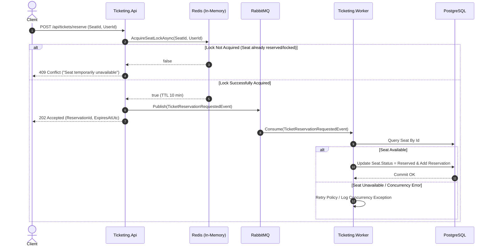

# 🎟️ High Concurrency Ticketing System

🌐 **English** | [Italiano](README.it.md)

[](https://dotnet.microsoft.com/)
[](https://docs.microsoft.com/dotnet/csharp/)
[](https://www.postgresql.org/)
[](https://redis.io/)
[](https://www.rabbitmq.com/)
[](https://masstransit.io/)
[](https://www.docker.com/)

A high-performance, event-driven distributed architecture designed to handle critical **high-concurrency** scenarios in ticket and event booking (e.g. concerts, matches, in-demand shows), preventing any **overbooking** and **race conditions**.

---

## 📌 Table of Contents

- [Problem Overview](#-problem-overview)
- [3-Layer Defense Architecture](#-3-layer-defense-architecture)
- [Flow Diagram](#-flow-diagram)
- [Solution Structure](#-solution-structure)
- [Tech Stack](#-tech-stack)
- [Prerequisites](#-prerequisites)
- [Quick Start](#-quick-start)
- [API Documentation](#-api-documentation)
- [Resilience and Concurrency Strategies](#-resilience-and-concurrency-strategies)
- [Possible Future Improvements](#-possible-future-improvements)

---

## 🎯 Problem Overview

In traditional ticketing systems, when thousands of users try to buy the same seat simultaneously:
1. The relational database quickly becomes the bottleneck due to row-level locks and blocking transactions.
2. Race conditions can occur, resulting in the same seat being sold multiple times (*double-booking*).
3. APIs suffer from latency spikes and connection timeouts.

**High Concurrence Ticketing** addresses these issues with an **Asynchronous / Event-Driven** pattern that decouples ingestion from processing, combined with **atomic distributed in-memory validation**.

---

## 🛡️ 3-Layer Defense Architecture

The system protects data integrity through three sequential, complementary layers:

```
[ HTTP Client ]
       │
       ▼
 ┌───────────────┐  1. In-Memory Lock (SETNX)
 │ Ticketing.Api │ ──────────────────────────► [ Redis Cache ]
 └───────┬───────┘   (Fast-fail on conflict)
         │
         │ 2. Async Event Publishing
         ▼
  [ RabbitMQ ] (Exchange / Queue)
         │
         │ 3. Async Processing with Retry
         ▼
┌──────────────────┐
│ Ticketing.Worker │ ──────────────────────────► [ PostgreSQL ]
└──────────────────┘  Final persistence and Concurrency Token (RowVersion)
```

1. **Layer 1: Fast-Fail with Distributed Lock on Redis**
   - When a request arrives, the API performs an atomic `SETNX` on Redis with a TTL (Time To Live of 10 minutes).
   - If the lock fails, a `409 Conflict` is returned immediately to the client with sub-millisecond latency, relieving the underlying infrastructure.
   - Lock release is protected by a **Lua** script, ensuring only the owning user can remove or update the lock.

2. **Layer 2: Buffering and Decoupling with RabbitMQ & MassTransit**
   - Once the temporary lock is acquired, the API publishes the `TicketReservationRequestedEvent` event and immediately replies to the client with `202 Accepted`.
   - The message broker absorbs load spikes, preventing the relational database from being overwhelmed.

3. **Layer 3: Persistence and Optimistic Concurrency on PostgreSQL**
   - `Ticketing.Worker` consumes the message from the queue.
   - It checks the seat state on PostgreSQL and records the reservation.
   - The `RowVersion` column (mapped to PostgreSQL's `xmin` via EF Core) raises a `DbUpdateConcurrencyException` on conflicting concurrent updates at the database level.
   - On transient errors, MassTransit applies an **exponential Retry Policy**.

---

## 🔄 Flow Diagram



---

## 📂 Solution Structure

The application follows **Clean Architecture** principles:

```
HighConcurrenceTicketing/
├── docker-compose.yml              # Docker services (Postgres 16, Redis 7, RabbitMQ 3)
├── HighConcurrenceTicketing.slnx   # Visual Studio Solution
└── src/
    ├── Ticketing.Api/              # REST API entry point (ASP.NET Core Web API)
    │   ├── Controllers/            # TicketsController (/reserve endpoint)
    │   ├── DTOs/                   # Request and Response DTOs
    │   └── Program.cs              # DI, Swagger, Redis, MassTransit configuration
    │
    ├── Ticketing.Worker/           # Background Service / Consumer
    │   ├── Consumers/              # TicketReservationConsumer
    │   └── Program.cs              # Host, MassTransit Consumer and Retry Policy
    │
    ├── Ticketing.Core/             # Domain Layer (pure C#, no external dependencies)
    │   ├── Entities/               # Seat, Reservation, SeatStatus
    │   ├── Events/                 # TicketReservationRequestedEvent
    │   └── Interfaces/             # ILockService
    │
    └── Ticketing.Infrastructure/   # Implementations and Data Access
        ├── Data/                   # TicketingDbContext (EF Core for Npgsql)
        ├── Migrations/             # EF Core migrations for PostgreSQL
        └── Services/               # RedisLockService (StackExchange.Redis + Lua)
```

---

## 🛠️ Tech Stack

- **Runtime & Framework**: [.NET 10.0](https://dotnet.microsoft.com/) / C# 13/14
- **Web API**: ASP.NET Core with controllers, Swagger / OpenAPI
- **ORM & Data Access**: [Entity Framework Core 10](https://learn.microsoft.com/ef/core/) with the [Npgsql.EntityFrameworkCore.PostgreSQL](https://www.npgsql.org/efcore/) provider
- **Distributed Caching & Locking**: [Redis](https://redis.io/) with [StackExchange.Redis](https://github.com/StackExchange/StackExchange.Redis)
- **Message Broker & Orchestration**: [RabbitMQ](https://www.rabbitmq.com/) with [MassTransit 8.3](https://masstransit.io/)
- **Containerization**: Docker & Docker Compose

---

## 📋 Prerequisites

- [.NET 10 SDK](https://dotnet.microsoft.com/download/dotnet/10.0) installed
- [Docker](https://www.docker.com/) and Docker Compose installed and running
- An API testing tool (e.g. `curl`, Postman, or the REST Client extension with `Ticketing.Api.http`)

---

## 🚀 Quick Start

### 1. Start the supporting services with Docker Compose
From the repository root, run:

```bash
docker compose up -d
```

This starts in the background:
- **PostgreSQL 16**: Port `5432` (`ticketing_db`, user: `postgres`, pass: `postgrespassword`)
- **Redis 7**: Port `6379`
- **RabbitMQ 3 Management**:
  - AMQP: Port `5672`
  - Management Dashboard UI: [http://localhost:15672](http://localhost:15672) (user: `guest`, pass: `guest`)

### 2. Apply database migrations
Run the migration to create the `Seats` and `Reservations` tables:

```bash
dotnet ef database update --project src/Ticketing.Infrastructure --startup-project src/Ticketing.Api
```

### 3. Start the Worker
Open a dedicated terminal and start the background worker:

```bash
dotnet run --project src/Ticketing.Worker
```

### 4. Start the API
Open a second terminal and start the API:

```bash
dotnet run --project src/Ticketing.Api
```

The API will be available at `https://localhost:7147` or `http://localhost:5045`.
To explore the endpoints with the interactive Swagger UI, open:
👉 **[http://localhost:5045/swagger](http://localhost:5045/swagger)**

---

## 📡 API Documentation

### Seat Reservation

Requests the temporary lock and processing of a seat reservation.

- **Method**: `POST`
- **URL**: `/api/tickets/reserve`
- **Headers**: `Content-Type: application/json`

#### Request Example (JSON):
```json
{
  "eventId": "a1b2c3d4-0000-0000-0000-000000000001",
  "seatId": "b2c3d4e5-0000-0000-0000-000000000002",
  "userId": "usr_998877"
}
```

#### Responses:

- **`202 Accepted`** - Lock acquired, request queued:
```json
{
  "reservationId": "f7d8c9a0-1234-5678-9abc-def012345678",
  "message": "Reservation request accepted.",
  "expiresAtUtc": "2026-10-01T12:10:00Z"
}
```

- **`409 Conflict`** - Seat already locked by another user:
```json
{
  "message": "The selected seat is temporarily locked or no longer available."
}
```

---

## ⚙️ Resilience and Concurrency Strategies

| Component | Strategy | Goal |
| :--- | :--- | :--- |
| **Redis** | `SETNX` with TTL (10 minutes) | Avoids deadlocks: if the user doesn't complete the purchase within 10 min, the seat is automatically unlocked. |
| **Redis** | Atomic release via **Lua** script | Prevents a worker or client from mistakenly releasing a lock owned by another user (`token matching`). |
| **RabbitMQ** | Persistent queue with MassTransit manual/automatic ACK | Guarantees no message is lost if the Worker restarts unexpectedly. |
| **MassTransit** | Exponential Backoff Retry (3 attempts, 100ms to 1s) | Handles transient connection errors to the relational database. |
| **PostgreSQL** | Optimistic Concurrency Token (`RowVersion` on `xmin`) | Protects the integrity of the `Seat` record without blocking pessimistic locks on the DB. |

---

## 🔮 Possible Future Improvements

- [ ] **Saga State Machine**: Implement a MassTransit State Machine (automating the 10-minute timeout, payment, and reservation cancellation).
- [ ] **Outbox Pattern**: Guarantee transactionality between message publishing and local database state.
- [ ] **WebSocket / SignalR**: Notify the client in real time of the actual reservation status and seat map availability.
- [ ] **Load Testing**: Benchmark suite with k6 or Bombardier to simulate thousands of concurrent requests per second.

---

## 📄 License

Distributed under the **MIT** license. See the `LICENSE` file for more information.
